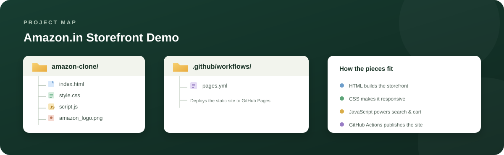



# Amazon.in Storefront Demo

A responsive storefront inspired by Amazon.in, built with **HTML, CSS, and vanilla JavaScript**. Browse sample departments, search the catalog, and try a persistent shopping cart.

> **Project type:** Front-end demo for learning and portfolio use. This is not an official Amazon product and does not place real orders.

## Contents

- [Features](#features)
- [Getting started](#getting-started)
- [How to use](#how-to-use)
- [Project structure](#project-structure)
- [Deploy with GitHub Pages](#deploy-with-github-pages)
- [Known limitations](#known-limitations)

## Features

- Responsive storefront layout for desktop, tablet, and mobile
- Sample departments for home, electronics, fashion, kitchen, and books
- Search by product/department text and filter by department
- Add items to the cart, change quantities, and remove items
- Cart item count and INR subtotal that update automatically
- Cart contents saved in browser `localStorage`
- Accessible form labels, dialog controls, and reduced-motion support
- Demo feedback for sign-in, delivery location, and checkout actions

## Getting started

A modern web browser is all you need. No package installation or build process is required.

1. Download or clone this repository.
2. Open `index.html` in your browser.

Or serve it locally from the project folder:

```bash
python -m http.server 8000
```

Then visit <http://localhost:8000>.

## How to use

1. Search for a department or item, or choose a department from the dropdown.
2. Select **Add to cart** on a card to add that demo item.
3. Select **Cart** in the header to change quantities, remove items, or view the subtotal.
4. Cart contents remain saved in the same browser after reload.

To reset the cart, remove its items in the cart panel or clear this site's local storage in your browser.

## Project structure

```text
amazon-clone/
├── .github/workflows/pages.yml  # Automatic GitHub Pages deployment
├── index.html                   # Storefront markup and sample catalog
├── style.css                    # Layout, responsive styles, and visual design
├── script.js                    # Search, cart state, and demo interactions
├── amazon_logo.png              # Local logo image
└── README.md                    # Project documentation
```

## Deploy with GitHub Pages

This repository includes a GitHub Actions workflow that publishes the static site whenever changes are pushed to the `main` branch. It can also be started manually from the repository's **Actions** tab.

For the first deployment, open the repository's **Settings → Pages** and set **Build and deployment → Source** to **GitHub Actions**. Then push the project to `main` and check the **Actions** tab for the deployment status. When it completes, GitHub Pages shows the live address under **Settings → Pages** (for this repository, the expected address is `https://anjali-thakur7691.github.io/amazon-clone/`).

## Known limitations

- This is a static front-end demo. It has no server, database, authentication, inventory, or payment processing.
- Sign-in and checkout only show demo messages; product names and prices are sample content.
- Product photography, Google Fonts, and Font Awesome icons load from external services and may require an internet connection.

